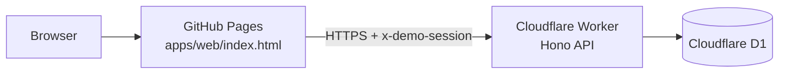

# BusinessFlow AI

Small teams drown in repetitive inquiries. BusinessFlow classifies intent, drafts a reply grounded in an approved policy, and requires a human decision before anything is recorded.

**Live application: https://bamaboy101.github.io/businessflow-ai/** — open it in any browser. No login, no installation, no local server.

| | |
|---|---|
| Frontend | https://bamaboy101.github.io/businessflow-ai/ |
| Backend API | https://businessflow-api.marketmesh-api.workers.dev |
| API health | https://businessflow-api.marketmesh-api.workers.dev/api/health |

## Architecture



The frontend is a single self-contained `apps/web/index.html` (React and Tailwind from CDN). There is **no build step**, so the committed file is exactly what is served — this removes any drift between source and deployment.

Three independent GitHub Actions workflows:

| Workflow | Purpose |
|---|---|
| `pages.yml` | Publishes `apps/web/index.html` to GitHub Pages and verifies the *published* HTML references the Worker |
| `ci.yml` | API typecheck (`tsc --noEmit`) and unit tests (`vitest`) with committed lockfiles |
| `e2e.yml` | Headless Chromium against the **live public URL**; uploads desktop + mobile screenshots, Playwright report, network/console diagnostics |

Frontend deployment is deliberately decoupled from backend tests, so a failing test can never take the public site down.

## Verified features

- Synthetic inquiry intake with deterministic intent classification (sales / billing / escalation / support)
- Policy lookup against approved FAQ snippets with source ids and revisions
- Draft replies cite the matched policy; unsupported claims are flagged
- Approve or Escalate, each recorded with actor, reason and timestamp
- Sandbox activity log and queue state, persisted per visitor and restored after reload

## Technologies

React (CDN) + Tailwind standalone frontend · Cloudflare Worker (Hono) · Cloudflare D1

## Running locally

```bash
git clone https://github.com/Bamaboy101/businessflow-ai.git
cd businessflow-ai/apps/api
npm ci
npm test            # unit tests
npm run build       # typecheck
npx wrangler dev    # API on http://localhost:8787
```

Serve `apps/web/index.html` with any static server to run the frontend locally.

### Browser acceptance tests

```bash
cd e2e
npm ci
npx playwright install chromium
APP_NAME=businessflow-ai WORKER_BASE=https://businessflow-api.marketmesh-api.workers.dev npx playwright test
```

Tests run against the deployed public URL by default and write screenshots to `e2e/screenshots/`.

## Security and data isolation

- **Anonymous sessions.** The Worker issues an opaque UUID session id; the browser stores it in `localStorage` and sends it as `x-demo-session`. Every record is stamped with that id and every read is filtered by it, so two different browsers never see each other's records, while a reload keeps your own history. Verified with two independent browser contexts.
- **Rate limiting.** 120 requests/minute per session; exceeding it returns `429` with `Retry-After`.
- **Request size ceiling.** Bodies above 512 KiB are rejected with `413`.
- **CORS allowlist.** Only the published GitHub Pages origin (and local dev origins) receive `Access-Control-Allow-Origin`; arbitrary origins receive none.
- **Input validation.** All write endpoints validate required fields and return `400` with a JSON error.
- **No secrets in the frontend.** The published HTML contains no API keys, tokens or credentials.

## Limitations and honest scope

- **No email is sent and no CRM is mutated.** Approvals write to a sandbox activity log only.
- Classification and drafting are deterministic and policy-grounded; no LLM inference is used or claimed.
- Use synthetic inquiries only — do not submit real customer data.

## Test evidence

| Check | Result |
|---|---|
| API typecheck + unit tests (`ci.yml`) | passing — 4 unit tests |
| GitHub Pages deployment (`pages.yml`) | passing — publishes `apps/web/index.html` and verifies the *published* HTML references the Worker |
| Browser acceptance (`e2e.yml`) | headless Chromium, desktop (1440×900) + mobile (Pixel 7), against the live public URL |
| Screenshots captured | 14 PNGs (desktop + mobile) uploaded as Actions artifacts |
| Session isolation | verified with two independent browser contexts |
| Persistence after reload | verified against the deployed Worker |

Latest browser acceptance run: https://github.com/Bamaboy101/businessflow-ai/actions/runs/43515496851

All runs, Playwright HTML reports, screenshots and network/console diagnostics:
**https://github.com/Bamaboy101/businessflow-ai/actions**

## License

MIT
