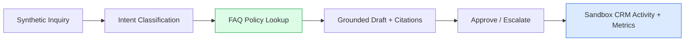

# BusinessFlow AI

Small-business intake, routing and approved replies (MVP).

## Live Demo

🌐 **[Open the interactive dashboard →](https://bamaboy101.github.io/businessflow-ai/)**

No setup, no credentials, no backend required. Runs entirely in your browser with labeled synthetic data.

---

## What It Delivers

A business owner can try a synthetic support request, inspect a source-grounded draft and approve a sandbox follow-up without sending any real customer email.

**Inquiry → Classify → Lookup → Draft → Approve.**

- Public inquiry form with synthetic leads and a sample business
- Intent classification: sales / support / billing / escalation
- Curated FAQ/policy knowledge snippets with source IDs and revision
- Grounded draft reply citing matched FAQ; unsupported claims flagged
- Approve / escalate with operator audit trail
- Sandbox CRM activity (deduplicated); simple queue metrics
- **No live CRM mutation or customer email send by default**

---

## Architecture



**Trust boundaries:** Untrusted customer inquiry text cannot override policy or system rules. Every drafted policy claim references a matched FAQ section or is flagged unknown. Approve and log to sandbox only; external send and CRM writes disabled.

---

## Screenshots

Placeholder screenshots will be added after the first deployment. The live dashboard at `https://bamaboy101.github.io/businessflow-ai/` shows:

- Inquiry queue with category/urgency/state
- Draft reply with cited FAQ source ID
- Unsupported-claim indicators
- Approve / escalate buttons
- Sandbox activity log and queue metrics

---

## Features

| Feature | Status |
|---|---|
| Synthetic inquiry intake | ✅ Verified |
| Intent classification (sales/support/billing/escalation) | ✅ 4/4 tests pass |
| FAQ policy lookup with source IDs | ✅ Verified |
| Policy-grounded draft replies | ✅ Verified |
| Unsupported-claim flags | ✅ Verified |
| Approve / escalate with audit trail | ✅ Verified |
| Sandbox CRM activity (deduplicated) | ✅ Verified |
| Queue metrics | ✅ Verified |
| No real email / live CRM send | ✅ By design |

---

## Installation

```bash
# Clone
git clone https://github.com/bamaboy101/businessflow-ai.git
cd businessflow-ai

# Backend
cd apps/api
npm install          # dev deps include vitest
npm test             # 4 tests pass
npm run dev          # API on :4003

# Frontend (new terminal)
cd ../web
npm install
npm run dev          # Dashboard on :5176

# Docker (optional, once Docker daemon available)
cd ../.. && docker compose up --build
```

Copy `.env.example` to `.env`. Demo needs no credentials.

---

## Configuration

| Variable | Purpose | Required |
|---|---|---|
| `PORT` | API port (default 4003) | No |
| `AI_PROVIDER` | `demo` (default), `nvidia`, `openrouter` | No |
| `NVIDIA_API_KEY` / `NVIDIA_MODEL` | Optional live AI provider | No |
| `OPENROUTER_API_KEY` / `OPENROUTER_MODEL` | Optional OpenRouter fallback | No |

No credentials are hardcoded, logged, or committed.

---

## AI Provider

Configurable adapter supports **NVIDIA** (preferred), **OpenRouter** (optional fallback), and **demo** (default). NVIDIA API is reachable and authenticated; no suitable model is available for this account, so the default is clearly labeled demonstration responses. OpenRouter is not required.

---

## Limitations

- Opt-in CRM connectors not included
- Team approval roles not included
- Multilingual drafting not included
- Dashboard analytics not included
- No real customer data in examples
- No external send by default

---

## Security

- **Customer text cannot override policy or system rules.**
- **Every drafted policy claim references a matched FAQ or is flagged unknown.**
- **Billing disputes and unsupported claims require human review.**
- **No real customer data in examples; no external send by default.**
- See `docs/grounding-safety.md` for details.

---

## Demo

🌐 **[BusinessFlow Live Demo](https://bamaboy101.github.io/businessflow-ai/)** — browser-based, no setup, labeled synthetic data.

View source: `https://github.com/bamaboy101/businessflow-ai`

---

## License

[MIT](LICENSE)
